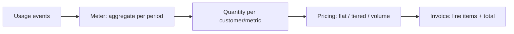

<p align="center">
  
</p>

<h1 align="center">Usage-Based Billing</h1>

<p align="center">
  <strong>A usage-based billing engine — metering, tiered/volume pricing, and invoice line items — in Python.</strong><br>
  Record usage events, price them with graduated or volume tiers, and assemble a clean invoice.
</p>

<p align="center">
  <em>Built and maintained by <a href="https://viprasol.com">Viprasol Tech</a> — Fintech Experts. Full-Stack Builders.</em>
</p>

<p align="center">
  <a href="https://github.com/Viprasol-Tech/usage-based-billing/actions/workflows/ci.yml"></a>
  <a href="LICENSE"></a>
  
  <a href="https://t.me/viprasol_help"></a>
  <a href="https://github.com/Viprasol-Tech/usage-based-billing/stargazers"></a>
</p>

---

## ✨ Features

- 📏 **Metering** — record `(customer, metric, quantity, ts)` events and aggregate per period.
- 🪜 **Graduated (tiered) pricing** — each quantity slice billed at its own tier rate.
- 📦 **Volume pricing** — the whole quantity billed at the single matching tier's rate.
- 💲 **Flat per-unit pricing** — one rate for every unit.
- 🧾 **Invoicing** — build line items and totals from metered usage and a price plan.
- 🎯 **Exact money math** — `Decimal` throughout, half-up rounding to cents; no float drift.
- 🖥️ **CLI** — `usage-based-billing demo` meters usage and prints an invoice, fully offline.
- ⚙️ **Modern tooling** — ruff, mypy (strict), pytest, GitHub Actions CI.

## 🚀 Quickstart

```bash
git clone https://github.com/Viprasol-Tech/usage-based-billing.git
cd usage-based-billing
python -m pip install -e ".[dev]"

# Meter synthetic usage and print an invoice:
usage-based-billing demo
usage-based-billing demo --customer globex-inc
```

## 🧩 Price usage in code

```python
from datetime import datetime
from usage_based_billing.meter import Meter
from usage_based_billing.invoice import PricePlan, build_invoice
from usage_based_billing.pricing import Tier, TieredPricing, VolumePricing, FlatPricing

meter = Meter()
meter.record("acme", "api_calls", 1_200, datetime(2025, 1, 10))
meter.record("acme", "seats", 5, datetime(2025, 1, 1))

plan = PricePlan(
    name="Growth",
    currency="USD",
    models={
        "api_calls": TieredPricing(
            [
                Tier(up_to=1_000, unit_price="0.001"),  # graduated
                Tier(up_to=None, unit_price="0.0005"),
            ]
        ),
        "seats": FlatPricing("8.00"),
    },
)

invoice = build_invoice(meter, plan, "acme", datetime(2025, 1, 1), datetime(2025, 2, 1))
for item in invoice.line_items:
    print(item.metric, item.quantity, item.amount)
print("TOTAL", invoice.total)
```

## 🏗️ Architecture



## 🗺️ Roadmap

- [x] Metering + per-period aggregation
- [x] Flat, graduated (tiered), and volume pricing
- [x] Invoice line items + totals with exact `Decimal` math
- [ ] Credits, minimum commitments, and proration
- [ ] Multi-currency plans and tax lines
- [ ] Stripe Billing export adapter

## 🤝 Contributing

PRs welcome — see [CONTRIBUTING.md](CONTRIBUTING.md) and our [Code of Conduct](CODE_OF_CONDUCT.md).

## Contact — Viprasol Tech Private Limited

- Website: [viprasol.com](https://viprasol.com)
- Email: [support@viprasol.com](mailto:support@viprasol.com)
- Telegram: [t.me/viprasol_help](https://t.me/viprasol_help) | WhatsApp: +91 96336 52112
- GitHub: [@Viprasol-Tech](https://github.com/Viprasol-Tech) | [LinkedIn](https://www.linkedin.com/in/viprasol/) | X [@viprasol](https://twitter.com/viprasol)

## License

[MIT](LICENSE) (c) 2025 Viprasol Tech Private Limited
